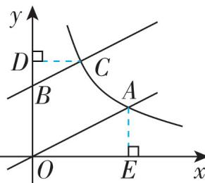

> [!success]- 必刷题
>
> > [!success] **【答案】** B
>
> > [!note]- **【解析】**
> > 如图, 过点 A 作 x 轴的垂线交 x 轴于点 E, 过点 C 作 y 轴的垂线交 y 轴于点 D, 则 AE // y 轴,
> >
> > 
> >
> > $\angle BDC = \angle AEO = 90^{\circ}$ . $\because$ 点 $A(4,2)$ 在函数 $y = \frac{k}{x} (k > 0,x > 0)$ 的图象上， $\therefore k = 4\times 2 = 8,\therefore$ 反比例函数表达式为 $y = \frac{8}{x} (x > 0)$ . $\because$ 点 $A$ 的坐标为 $(4,2),\therefore OE = 4,AE = 2,\therefore OA = \sqrt{2^2 + 4^2} = 2\sqrt{5}$ . $\because$ 将直线 $OA$ 沿 $y$ 轴向上平移后得到直线 $BC,\therefore OA / / BC,\therefore \angle DBC = \angle BOA.\because AE / / y$ 轴， $\therefore \angle OAE = \angle BOA,\therefore \angle DBC = \angle OAE,$ $\therefore \triangle DBC \sim \triangle EAO,\therefore \frac{CD}{BC} = \frac{OE}{OA},\therefore \frac{CD}{\sqrt{5}} = \frac{4}{2\sqrt{5}},$ $\therefore CD = 2$ ，即点 $C$ 的横坐标为2.将 $x = 2$ 代入 $y = \frac{8}{x} (x > 0)$ ，得 $y = 4,\therefore C$ 点的坐标为 $(2,4),$ $\therefore CD = 2,OD = 4,\therefore BD = \sqrt{BC^2 - CD^2} =$ $\sqrt{(\sqrt{5})^2 - 2^2} = 1,\therefore OB = OD - BD = 4 - 1 = 3,$ $\therefore B(0,3)$ .故选B.
> >
> > 思路分析
> > (1) 将 A(4, 0), B(0, 2) 代入 $y = kx + b$ ，求得一次函数表达式，进而可得点 C 的坐标，再将点 C 的坐标代入反比例函数表达式即可；
> >
> > (2) 将一次函数与反比例函数表达式联立成方程组, 求得交点坐标即可得出结果.
