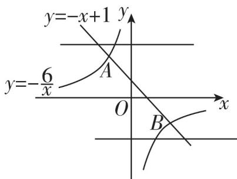

> [!success]- 必刷题
>
> > [!success] **【答案】** $a = 3, k = -6$
>
> > [!note]- **【解析】**
> > (1) ∵ 直线 $y = -x + 1$ 与函数 $y = \frac{k}{x}$ 的图象交于 $A(-2, a)$ , 把 $A(-2, a)$ 代入 $y = -x + 1$ , 解得 $a = 3, \therefore A(-2, 3)$ . 把 $A(-2, 3)$ 代入 $y = \frac{k}{x}$ , 解得 $k = -6$ . 故答案为 $a = 3, k = -6$ .
> >
> > (2) 画出函数图象如图. 解方程组 $\left\{ \begin{array}{l} y = -\frac{6}{x}, \\ y = -x + 1, \end{array} \right.$
> >
> > 得 $\left\{\begin{aligned}x&=-2,\\ y&=3\end{aligned}\right.$ 或 $\left\{\begin{aligned}x&=3,\\ y&=-2.\end{aligned}\right.$ ∵ A(-2,3), ∴ B(3,
> > -2). ∵ C(x₁, y₁),
> > D(x₂, y₂), ∴ 根据图
> >
> > 
> >
> > 象, 可得若 $\left|x_{1}\right| \leqslant \left|x_{2}\right|$ , 则 $m \geqslant 3$ 或 $m \leqslant -2$ . 故答案为 $m \geqslant 3$ 或 $m \leqslant -2$ .
