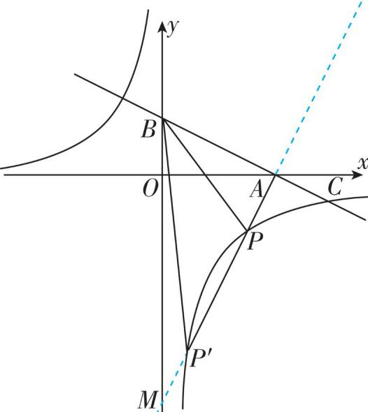

> [!success]- 必刷题
>
> > [!success] **【答案】** 详见解析
>
> > [!note]- **【解析】**
> > 【解】(1)把 $A(4,0), B(0,2)$ 代入 $y = kx + b$ 中得 $\left\{ \begin{array}{l} 4k + b = 0, \\ b = 2, \end{array} \right.\therefore \left\{ \begin{array}{l} k = -\frac{1}{2}, \\ b = 2, \end{array} \right.\therefore$ 直线 $y = kx + b$ 的表达式为 $y = -\frac{1}{2} x + 2$ . 在 $y = -\frac{1}{2} x + 2$ 中, 当 $x = 6$ 时, $y = -\frac{1}{2} \times 6 + 2 = -1, \therefore C(6, -1)$ . 把 $C(6, -1)$ 代入 $y = \frac{m}{x}$ 中得 $-1 = \frac{m}{6}, \therefore m = -6, \therefore$ 反比例函数的表达式为 $y = -\frac{6}{x}$ .
> >
> > (2) $x < -2$ 或 $0 < x < 6$ .
> >
> > 联立得 $\left\{ \begin{array}{l} y = -\frac{1}{2} x + 2, \\ y = -\frac{6}{x}, \end{array} \right.$ 解得 $\left\{ \begin{array}{l} x = 6, \\ y = -1 \end{array} \right.$ 或 $\left\{ \begin{array}{l} x = -2, \\ y = 3, \end{array} \right.$ ∴一次函数图象与反比例函数图象的两个交点坐标分别为 (6, -1), (-2, 3).
> >
> > 由函数图象可知, 当 $x < -2$ 或 $0 < x < 6$ 时, 一次函数图象在反比例函数图象上方,
> >
> > ∴当 $kx + b > \frac{m}{x}$ 时, $x < -2$ 或 $0 < x < 6$ .
> >
> > (3)存在. 如图所示,作直线 $AP \perp$ 直线 $AB$ 交 $y$ 轴于点 $M$ , 设 $M(0,m)$ .
> >
> > 
> >
> > $\because A(4,0), B(0,2), \therefore BM^{2} = |2 - m|^{2} = m^{2} - 4m + 4, AB^{2} = 2^{2} + 4^{2} = 20, AM^{2} = 4^{2} + m^{2} = m^{2} + 16.$ $\because \angle BAM = 90^{\circ}, \therefore BM^{2} = BA^{2} + AM^{2}, \therefore m^{2} - 4m +$ 初中必刷题 数学九年级上册 BS $4=20+m^{2}+16$ , 解得 m=-8, ∴ $M(0,-8)$ ,
> > 易得直线 AM 的表达式为 y=2x-8.
> > 联立得 $\left\{\begin{aligned}y&=2x-8,\\ y&=-\frac{6}{x},\end{aligned}\right.$ 解得 $\left\{\begin{aligned}x&=3,\\ y&=-2\end{aligned}\right.$ 或 $\left\{\begin{aligned}x&=1,\\ y&=-6,\end{aligned}\right.$ ∴ 点 P 的坐标为 $(3,-2)$ 或 $(1,-6)$ .
