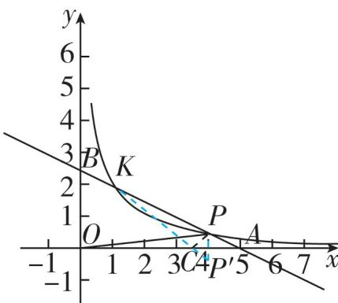

> [!success]- 必刷题
>
> > [!success] **【答案】** C
>
> > [!note]- **【解析】**
> > 【解】(1)∵一次函数 $y_{1}=k_{1}x+b$ 的图象与坐标轴分别交于 A(5,0)， $B\left(0,\frac{5}{2}\right)$ 两点，
> >
> > ∴ $\left\{\begin{aligned}&5k_{1}+b=0,\\&b=\frac{5}{2},\end{aligned}\right.$ 解得 $\left\{\begin{aligned}&k_{1}=-\frac{1}{2},\\&b=\frac{5}{2},\end{aligned}\right.$ ∴一次函数的表达式为 $y_{1}=-\frac{1}{2}x+\frac{5}{2}$ . ∵△OAP 的面积为 $\frac{5}{4},\therefore\frac{1}{2}\cdot OA\cdot y_{P}=\frac{5}{4},\therefore y_{P}=\frac{1}{2}$ . ∵点 P 在一次函数图象上，∴令 $-\frac{1}{2}x+\frac{5}{2}=\frac{1}{2}$ ，解得 x=4，
> >
> > ∴ $P\left(4,\frac{1}{2}\right)$ . ∵点 P 在反比例函数 $y_{2}=\frac{k_{2}}{x}$ 的图象上，∴ $k_{2}=4\times\frac{1}{2}=2$ ，∴反比例函数的表达式为 $y_{2}=\frac{2}{x}$ .
> >
> > (2) 令 $-\frac{1}{2} x + \frac{5}{2} = \frac{2}{x}$ , 解得 $x = 1$ 或 $x = 4$ ,
> >
> > ∴ $K(1,2)$ . 如图, 作点 P 关于 x 轴的对称点 $P'$ , 连接 $KP'$ , 线段 $KP'$ 与 x 轴的交点即为 $PC+KC$ 最小时的点 C, 连接
> >
> > 
> >
> > $PC.\because P\left(4,\frac{1}{2}\right),\quad \therefore P^{\prime}\left(4, - \frac{1}{2}\right),\quad \therefore PP^{\prime} = 1,$ ∴直线 $KP^{\prime}$ 的表达式为 $y = -\frac{5}{6} x + \frac{17}{6}$ .令 $y = 0$ 解得 $x = \frac{17}{5},\therefore C\left(\frac{17}{5},0\right),\therefore S_{\triangle PKC} = S_{\triangle PP'K}-$ $S_{\triangle PP'C} = \frac{1}{2}\cdot (x_C - x_K)\cdot PP' = \frac{1}{2}\times \left(\frac{17}{5} -1\right)\times 1 =$ $\frac{6}{5},\therefore$ 当 $PC + KC$ 最小时，△PKC的面积为 $\frac{6}{5}$
