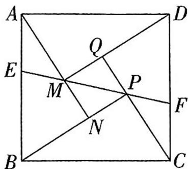
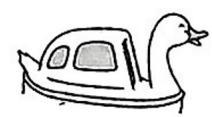

<!-- question-source:start -->
4 [2024 湖北武汉中考] 如图是我国汉代数学家赵爽在注解《周髀算经》时给出的“赵爽弦图”，它是由四个全等的直角三角形和中间的小正方形 MNPQ 拼成的一个大正方形 ABCD。直线 MP 交正方形 ABCD 的两边于点 E, F，记正方形 ABCD 的面积为 $S_{1}$ ，正方形 MNPQ 的面积为 $S_{2}$ 。若 $BE = kAE (k > 1)$ ，则用含 k 的式子表示 $\frac{S_{1}}{S_{2}}$ 的值是 \_\_\_\_.

轻舟已过万重山了鸭
- 新考向 2 开放性试题
<!-- question-source:end -->

![[Q00108249A1]]
