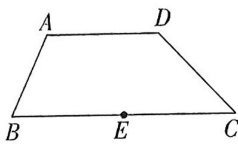

<!-- question-source:start -->
7 [2024 江苏宿迁中考] 如图, 在四边形 $ABCD$ 中, $AD \parallel BC$ , 且 $AD = DC = \frac{1}{2} BC$ , $E$ 是 $BC$ 的中点. 下面是甲、乙两名同学得到的结论: 甲: 若连接 $AE$ , 则四边形 $ADCE$ 是菱形; 乙: 若连接 $AC$ , 则 $\triangle ABC$ 是直角三角形. 请选择一名同学的结论给予证明.

<!-- question-source:end -->

![[Q00108252A1]]
