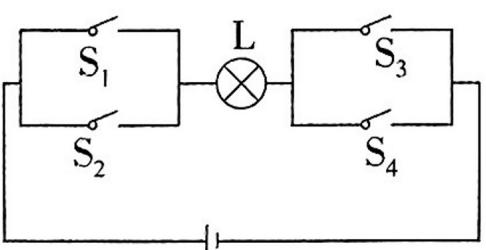
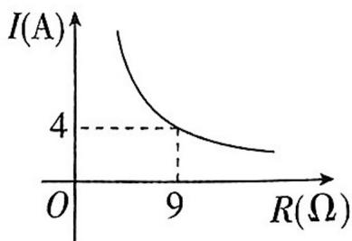

<!-- question-source:start -->
8[2024 四川绵阳中考]如图,电路上有 $S_{1}, S_{2}, S_{3}, S_{4}$ 四个断开的开关和一个正常的小灯泡 L, 将这些开关随机闭合至少两个,能让灯泡发光的概率为 ( )
A. $\frac{3}{5}$ B. $\frac{7}{11}$ C. $\frac{4}{5}$ D. $\frac{9}{11}$

(第8题图)

(第9题图)
<!-- question-source:end -->

![[Q00108253A1]]
