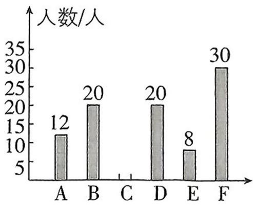
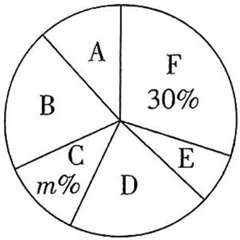

<!-- question-source:start -->
10[2024 四川遂宁中考]遂宁市作为全国旅游城市,有众多著名景点,为了解“五一”假期同学们的出游情况,某实践探究小组对部分同学假期旅游地做了调查,以下是调查报告的部分内容,请完善报告:

<table><tr><td colspan="4">数据收集</td></tr><tr><td>调查方式</td><td>抽样调查</td><td>调查对象</td><td>××学校学生</td></tr><tr><td colspan="4">数据的整理与描述</td></tr><tr><td rowspan="2">景点</td><td>A:中国死海</td><td>B:龙凤古镇</td><td>C:灵泉风景区</td></tr><tr><td>D:金华山</td><td>E:未出游</td><td>F:其他</td></tr></table>

被抽样调查学生人数条形统计图

被抽样调查学生人数占比

数据分析及运用

(1)本次被抽样调查的学生总人数为\_\_\_\_，扇形统计图中，m=\_\_\_\_，“B:龙凤古镇”对应圆心角的度数是\_\_\_\_；

(2)请补全条形统计图；

(3)该学校总人数为 1800 人,请你估计该学校学生“五一”假期未出游的人数;

(4)未出游中的甲、乙两位同学计划下次假期从 A、B、C、D 四个景点中任选一个景点旅游,请用树状图或列表的方法求出他们选择同一景点的概率
<!-- question-source:end -->

![[Q00108255A1]]
