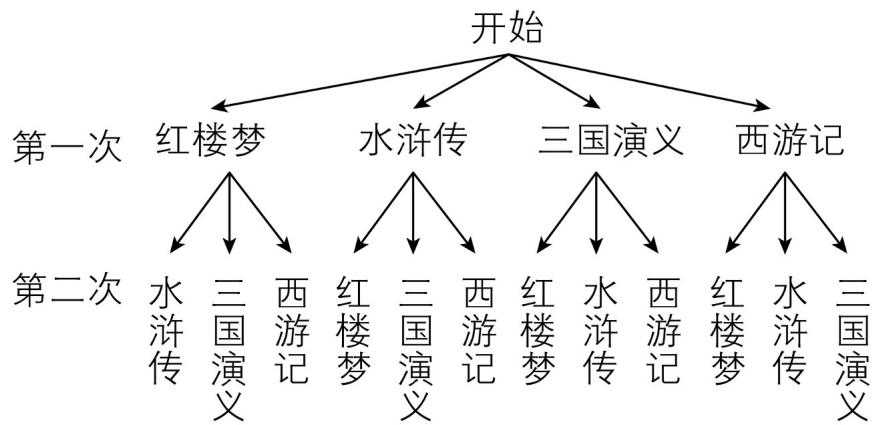

> [!success]- 必刷题
>
> > [!success] **【答案】** $\frac{1}{6}$
>
> > [!note]- **【解析】**
> > 画树状图如下：
> >
> > 
> >
> > 一共有 12 种等可能的结果, 其中恰好抽取到《三国演义》和《西游记》的结果有 2 种, ∴ P (恰好抽取到《三国演义》和《西游记》) = $\frac{2}{12} = \frac{1}{6}$ . 故答案为 $\frac{1}{6}$ .
