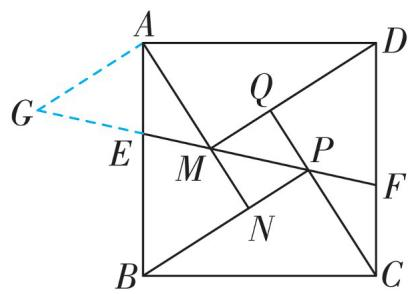

> [!success]- 必刷题
>
> > [!success] **【答案】** $\frac{k^2 + 1}{(k - 1)^2}$
>
> > [!note]- **【解析】**
> > 如图，过 $A$ 作 $AG / / BP$ 交 $FE$ 延长线于点 $G, \therefore \angle GAE = \angle PBE,$ $\angle AGE = \angle BPE, \therefore \triangle AGE\sim$
> >
> > 
> >
> > $\triangle BPE, \therefore \frac{AG}{BP} = \frac{AE}{BE} = \frac{1}{k}$ . 设 $AG = 1$ , 则 $BP = k$ . $\because \angle GAM = \angle ANP = 90^{\circ}, \angle NMP = 45^{\circ}, \therefore \angle AMG = 45^{\circ}, \therefore AM = AG = 1.$ $\because AN = MD = BP = k, \therefore MN = k - 1.$ $\because S_{1} = AD^{2} = AM^{2} + MD^{2} = 1 + k^{2}, S_{2} = MN^{2} = (k - 1)^{2},$ $\therefore \frac{S_{1}}{S_{2}} = \frac{k^{2} + 1}{(k - 1)^{2}}.$
