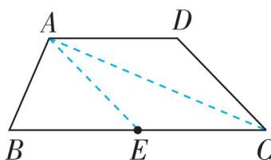

> [!success]- 必刷题
>
> > [!success] **【答案】** B
>
> > [!note]- **【解析】**
> > 【证明】甲:如图,连接 AE.∵ E 是 BC 的中点,
> > ∴ $EC=\frac{1}{2}BC$ . ∵ $AD=\frac{1}{2}BC$ , ∴ $AD=EC$ . ∵ $AD\parallel BC$ ,
> > ∴ 四边形 ADCE 是平行四边形. ∵ AD = DC, ∴ 四边形 ADCE 是菱形.
> >
> > 乙:如图,连接 AC. ∵ 同甲可得四边形 ADCE 是菱形, ∴ AE = CE = BE, ∴ ∠EAC = ∠ECA,
> >
> > 
> >
> > $\angle EAB = \angle B.\because \angle EAC + \angle ECA + \angle EAB + \angle B = 180^{\circ},$ $\therefore 2\angle EAC + 2\angle EAB = 180^{\circ},\therefore \angle EAC + \angle EAB = 90^{\circ},$ $\therefore \angle BAC = 90^{\circ},\therefore \triangle ABC$ 是直角三角形.（任选其中一名同学的结论证明即可）
