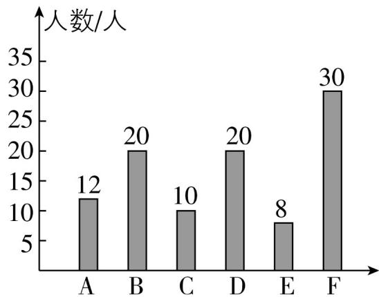
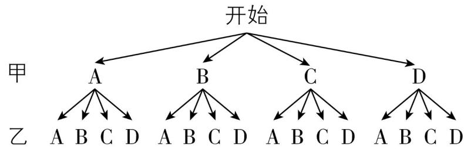

> [!success]- 必刷题
>
> > [!success] **【答案】** A
>
> > [!note]- **【解析】**
> > 【解】(1)∵30÷30%=100(人),
> > ∴本次被抽样调查的学生总人数为100人,
> > ∴假期旅游地为景点C的人数为100-(12+20+20+8+30)=10(人),
> > ∴m%= $\frac{10}{100}$ ×100%=10%,∴m=10.
> > ∵ $\frac{20}{100}\times360^{\circ}=72^{\circ}$ ,
> > ∴“B:龙凤古镇”对应圆心角的度数是72°.
> > 故答案为100人,10,72°.
> >
> > 
> >
> > (3) $\frac{8}{100}\times1\ 800=144$ (人).
> > 答:估计该学校学生“五一”假期未出游的有144人.
> >
> > (4)画树状图如下:
> >
> > 
> >
> > 一共有 16 种等可能的结果, 其中他们选择同一景点的结果有 4 种, ∴ P (他们选择同一景点) = $\frac{4}{16} = \frac{1}{4}$ .
