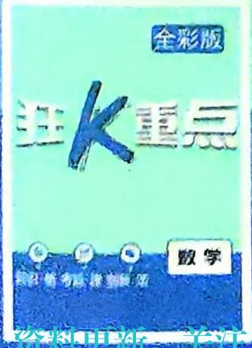
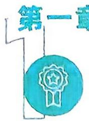
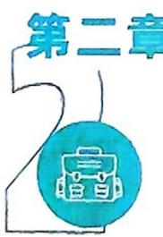
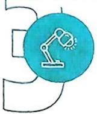
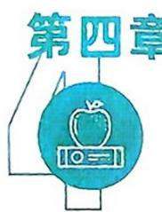
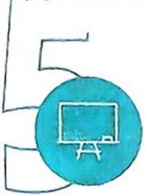

<!-- source-part:1 pages:1-25 -->

# 初中 BISHUATI 2026 初中 必刷题®

要做自变量
让世界因你而变

数学

九年级上册 BS

# 初中 2026 必刷题

主 编：杨文彬

编者：王岳阳 谢淑霞 许生友 李培华 王道魁

审 订：杨彩银

开明出版社

数学
九年级上册 BS

## 目录

## 第一章 特殊平行四边形

1 菱形的性质与判定 …… (1) (D1)
课时 1 菱形的性质 …… 刷基础 提升 (1) (D1)
课时 2 菱形的判定 …… 刷基础 提升 (3) (D3)
课时 3 菱形的性质与判定的综合应用 …… 刷提升 (5) (D5)
2 矩形的性质与判定 …… (6) (D6)
课时 1 矩形的性质 …… 刷基础 提升 (6) (D6)
课时 2 矩形的判定 …… 刷基础 提升 (9) (D8)
课时 3 矩形的性质与判定的综合应用 …… 刷提升 (11) (D10)
3 正方形的性质与判定 …… (12) (D11)
课时 1 正方形的性质 …… 刷基础 提升 (12) (D11)
课时 2 正方形的判定 …… 刷基础 提升 (14) (D14)
重难专题 1 特殊平行四边形中折叠求长度 … 刷难关 (16) (D16)
大招专题 1 正方形中的三种常考模型 …… 刷难关 (17) (D18)
大招专题 2 特殊平行四边形中的最值问题 … 刷难关 (19) (D20)
全章综合训练 …… 刷中考 章测 (20) (D21)

## 重难题型微课

<table><tr><td>矩形的旋转</td><td>P11T4</td><td>含90°角的对角互补模型</td><td>P15T6</td></tr><tr><td>正方形的折叠</td><td>P16T1</td><td>平行四边形的动点问题</td><td>P21T7</td></tr><tr><td>矩形与菱形的综合</td><td>P22T10</td><td></td><td></td></tr></table>

## 第二章 一元二次方程

1 认识一元二次方程 …… (23) (D25)
课时 1 认识一元二次方程 …… 刷基础 (23) (D25)
课时 2 一元二次方程的解及其估算 …… 刷基础 (24) (D25)
2 用配方法求解一元二次方程 …… (25) (D26)
课时 1 用直接开平方法和配方法求解二次项系数为 1 的一元二次方程 …… 刷基础 提升 (25) (D26)
课时 2 用配方法求解二次项系数不为 1 的一元二次方程 …… 刷基础 提升 (27) (D27)
3 用公式法求解一元二次方程 …… (29) (D29)
课时 1 用公式法求解一元二次方程 …… 刷基础 提升 (29) (D29)
课时 2 用公式法求解一元二次方程的应用 …… 刷提升 (31) (D31)

4 用因式分解法求解一元二次方程
基础 提升（32）(D31)

## 新考法 新素材

研究对比全国近十年中考真题卷,发现各省市的中考会不断借鉴或探究新考法,同时会挖掘时事热点等新素材,创造新情境灵活考查知识点。中考是我们平时学习的风向标,因此我们需要关注新考法、新素材。

## 新考法

\- 三角形拼接成正方形 ▶P15/T1
- 数形结合求方程的解 ▶P26/T2
- 应用一元二次方程解决
    几何图形问题 ▶P36/T2
- 以统计图为背景的平均
    增长率问题 ▶P37/T5
- 方程的根与直角三角形
    的综合 ▶P39/T4
- 求两人座位相对的概率
    ▶P43/T2
- 利用俯视图判断足球是
    否出界 ▶P80/T3
- 手影游戏中的相似 ▶P84/T3

## 新素材

\- 以“第九届亚洲冬季运动会”为背景考查一元二次方程的应用
- 以“2025第14届深圳国际导热散热材料及设备展览会”为背景考查概率
- P37/T8
- P49/T1

## 新考向

## 推荐理由

教育部发布的《关于加强初中学业水平考试命题工作的意见》中指出：弘扬中华优秀传统文化，提高探究性、开放性试题比例，积极探索跨学科命题，提高试题情境设计水平。结合《义务教育数学课程标准(2022年版)》新变化，通过分析全国百余套中考试题，发现以传统文化为背景的试题，以及探究性、开放性、综合性、跨学科试题在中考中出现得越来越频繁，故精选部分试题，让学生感受考向变化。

微专题 1 特殊平行四边形中等积法的应用
微专题 2 配方法的应用
微专题 3 用“十字相乘法”解一元二次方程
微专题 4 概率中的放回与不放回问题
微专题 5 三角形内接四边形
微专题 6 反比例函数中与面积相关的解题方法

## 目录

\*5 一元二次方程的根与系数的关系 …… 刷基础 (34) (D33)
6 应用一元二次方程 …… (35) (D34)
课时1 一元二次方程在实际问题中的应用(1)
…… 刷基础 提升 (35) (D34)
课时2 一元二次方程在实际问题中的应用(2)
…… 刷基础 提升 (37) (D35)
全章综合训练 …… 刷中考 章测 (39) (D36)

## 重难题型微课

已知方程的根求代数式的值 P24T7 一元二次方程的图形解法 P26T2
一元二次方程与动点问题 P41T17

## 第三章 概率的进一步认识

1 用树状图或表格求概率 …… (42) (D39)
课时 1 用树状图或表格求概率…… 刷基础 提升 (42) (D39)
课时 2 用概率判断游戏公平性 …… 刷基础 (44) (D41)
课时 3 用概率玩“配紫色”游戏 …… 刷基础 (45) (D42)
2 用频率估计概率 …… 刷基础 提升 (46) (D43)
全章综合训练 …… 刷中考 章测 (48) (D44)

## 第四章 图形的相似

1 成比例线段 …… (50) (D46)
课时 1 成比例线段及比例的基本性质 … 刷基础 (50) (D46)
课时 2 比例的其他性质 …… 刷基础 (51) (D47)

2 平行线分线段成比例 …… 刷基础 提升 (52) (D48)

3 相似多边形 …… 刷基础 (54) (D49)

4 探索三角形相似的条件 …… (55) (D50)
课时 1 相似三角形的概念及判定定理 1
…… 刷基础 提升 (55) (D50)
课时 2 相似三角形的判定定理 2 … 刷基础 提升 (57) (D52)
课时 3 相似三角形的判定定理 3 …… 刷基础 (59) (D54)
课时 4 黄金分割 …… 刷基础 (60) (D55)

大招专题 3 相似三角形判定的常考模型 …… 刷难关 (61) (D56)

5 相似三角形判定定理的证明 …… 刷基础 (63) (D59)

6 利用相似三角形测高 …… 刷基础 提升 (64) (D60)

7 相似三角形的性质 …… (66) (D61)
课时 1 相似三角形中对应线段的性质 … 刷基础 (66) (D61)
课时 2 相似三角形的周长比、面积比的性质
…… 刷基础 提升 (67) (D62)

重难专题 2 相似三角形与其他知识的综合 … 刷难关 (70) (D65)

## 专题索引

## 微专题

## 重难专题

## 重难专题1 特殊平行四边形中折叠求长度

类型 1 把一个顶点折叠到一边上
类型 2 把一个顶点折叠到对角线上
类型 3 把一个顶点折叠到另一个顶点上
类型 4 把一个顶点折叠到图形内或图形外
类型 5 多次折叠

## 重难专题2 相似三角形与其他知识的综合

类型 1 相似三角形与函数的综合

类型 2 相似三角形与其他图形的综合

类型 3 几何动态与相似三角形的综合

## 重难专题3 反比例函数与一次函数的综合应用

类型1 交点问题
类型2 取值范围问题
类型3 存在性问题
类型4 几何图形面积问题

## 目录

8 图形的位似 …… (71) (D66)
课时 1 图形的位似 …… 刷基础 (71) (D66)
课时 2 平面直角坐标系中的位似变换 …… 刷基础 (72) (D67)
全章综合训练 …… 刷中考 章测 (73) (D68)

## 重难题型微课

平行线分线段成比例的应用 P53T2 相似三角形的判定 P56T5
黄金分割与图形面积的综合 P60T9 相似模型之一线三等角 P62T8
相似三角形的面积比 P68T6 位似中心的确定 P72T4

## 第五章 投影与视图

1 投影……(76)(D71)
课时1 中心投影……刷基础 提升 (76)(D71)
课时2 平行投影……刷基础 (78)(D72)
2 视图……(79)(D73)
课时1 认识三视图……刷基础 提升 (79)(D73)
课时2 直棱柱的三视图……刷基础 (81)(D74)
课时3 由三视图判断几何体……刷基础 (82)(D74)
全章综合训练……刷中考 章测 (83)(D75)
重难题型微课
添加(减少)小正方体问题 P80T4 由三视图还原几何体 P84T5

## 第六章 反比例函数

1 反比例函数……刷基础 (85) (D76)
2 反比例函数的图象与性质…… (86) (D76)
课时1 反比例函数的图象 ……刷基础 (86) (D76)
课时2 反比例函数的性质……刷基础 提升 (87) (D77)
3 反比例函数的应用……刷基础 提升 (89) (D79)
大招专题4 反比例函数中k的几何意义 ……刷难关 (91) (D81)
重难专题3 反比例函数与一次函数的综合应用
……刷难关 (93) (D83)
全章综合训练 ……刷中考 章测 (94) (D84)

## 重难题型微课

“三角形”化“梯形”模型 P92T2 结合函数图象求参 P93T2
反比例函数与一次函数的综合 P93T4 反比例函数与三角形的综合 P94T4
反比例函数的图象与性质 P95T1

## 中考新考向备训

\- 新考向 1 传统文化
- 新考向 3 跨学科综合
- 新考向 2 开放性试题
- 新考向 4 项目化学习

## 专题索引

## 大招专题

## 大招专题1 正方形中的三种常考模型

母题学大招1 “十字架”模型
母题学大招2 对角互补模型
母题学大招3 半角模型

大招专题2 特殊平行四边形中的最值问题
母题学大招4 根据垂线段最短求最值
母题学大招5 根据三角形三边关系求最值
母题学大招6 “将军饮马”求最值
母题学大招7 “费马定理”求最值

## 大招专题3 相似三角形判定的常考模型

母题学大招8 A字型
母题学大招9 8字型
母题学大招10 手拉手型
母题学大招11 一线三等角型
母题学大招12 射影定理(子母型)
母题学大招13 十字型

## 大招专题4 反比例函数中 $k$ 的几何意义

母题学大招 14 一点一垂线
母题学大招 15 一点两垂线
母题学大招 16 两点两垂线
母题学大招 17 两曲一平行

![[初中/课堂同步/教辅/必刷题/2026《初中必刷题》数学北师9上/01_第一章_特殊平行四边形/课时_1_菱形的性质/刷基础.md]]
![[初中/课堂同步/教辅/必刷题/2026《初中必刷题》数学北师9上/01_第一章_特殊平行四边形/课时_1_菱形的性质/刷提升.md]]
![[初中/课堂同步/教辅/必刷题/2026《初中必刷题》数学北师9上/01_第一章_特殊平行四边形/课时_2_菱形的判定/刷基础.md]]
![[初中/课堂同步/教辅/必刷题/2026《初中必刷题》数学北师9上/01_第一章_特殊平行四边形/课时_2_菱形的判定/刷提升.md]]
![[初中/课堂同步/教辅/必刷题/2026《初中必刷题》数学北师9上/01_第一章_特殊平行四边形/课时_3_菱形的性质与判定的综合应用/刷提升.md]]
![[初中/课堂同步/教辅/必刷题/2026《初中必刷题》数学北师9上/01_第一章_特殊平行四边形/课时_1_矩形的性质/刷基础.md]]
![[初中/课堂同步/教辅/必刷题/2026《初中必刷题》数学北师9上/01_第一章_特殊平行四边形/课时_1_矩形的性质/刷提升.md]]
![[初中/课堂同步/教辅/必刷题/2026《初中必刷题》数学北师9上/01_第一章_特殊平行四边形/课时_2_矩形的判定/刷基础.md]]
![[初中/课堂同步/教辅/必刷题/2026《初中必刷题》数学北师9上/01_第一章_特殊平行四边形/课时_2_矩形的判定/刷提升.md]]
![[初中/课堂同步/教辅/必刷题/2026《初中必刷题》数学北师9上/01_第一章_特殊平行四边形/课时_3_矩形的性质与判定的综合应用/刷提升.md]]
![[初中/课堂同步/教辅/必刷题/2026《初中必刷题》数学北师9上/01_第一章_特殊平行四边形/课时_1_正方形的性质/刷基础.md]]
![[初中/课堂同步/教辅/必刷题/2026《初中必刷题》数学北师9上/01_第一章_特殊平行四边形/课时_1_正方形的性质/刷提升.md]]
![[初中/课堂同步/教辅/必刷题/2026《初中必刷题》数学北师9上/01_第一章_特殊平行四边形/课时_2_正方形的判定/刷基础.md]]
![[初中/课堂同步/教辅/必刷题/2026《初中必刷题》数学北师9上/01_第一章_特殊平行四边形/课时_2_正方形的判定/刷提升.md]]
![[初中/课堂同步/教辅/必刷题/2026《初中必刷题》数学北师9上/01_第一章_特殊平行四边形/重难专题_1_特殊平行四边形中折叠求长度/重难专题_1_特殊平行四边形中折叠求长度.md]]
![[初中/课堂同步/教辅/必刷题/2026《初中必刷题》数学北师9上/01_第一章_特殊平行四边形/大招专题_1_正方形中的三种常考模型/大招专题_1_正方形中的三种常考模型.md]]
![[初中/课堂同步/教辅/必刷题/2026《初中必刷题》数学北师9上/01_第一章_特殊平行四边形/大招专题_2_特殊平行四边形中的最值问题/大招专题_2_特殊平行四边形中的最值问题.md]]
![[初中/课堂同步/教辅/必刷题/2026《初中必刷题》数学北师9上/01_第一章_特殊平行四边形/全章综合训练/刷中考.md]]
![[初中/课堂同步/教辅/必刷题/2026《初中必刷题》数学北师9上/01_第一章_特殊平行四边形/全章综合训练/刷章测.md]]
![[初中/课堂同步/教辅/必刷题/2026《初中必刷题》数学北师9上/02_第二章_一元二次方程/课时_1_认识一元二次方程/刷基础.md]]
![[初中/课堂同步/教辅/必刷题/2026《初中必刷题》数学北师9上/02_第二章_一元二次方程/课时_2_一元二次方程的解及其估算/刷基础.md]]
![[初中/课堂同步/教辅/必刷题/2026《初中必刷题》数学北师9上/02_第二章_一元二次方程/课时_1_用直接开平方法和配方法求解二次项系数为_1_的一元二次方程/刷基础.md]]
![[初中/课堂同步/教辅/必刷题/2026《初中必刷题》数学北师9上/02_第二章_一元二次方程/课时_1_用直接开平方法和配方法求解二次项系数为_1_的一元二次方程/刷提升.md]]
![[初中/课堂同步/教辅/必刷题/2026《初中必刷题》数学北师9上/02_第二章_一元二次方程/课时_2_用配方法求解二次项系数不为_1_的一元二次方程/刷基础.md]]
![[初中/课堂同步/教辅/必刷题/2026《初中必刷题》数学北师9上/02_第二章_一元二次方程/课时_2_用配方法求解二次项系数不为_1_的一元二次方程/刷提升.md]]
![[初中/课堂同步/教辅/必刷题/2026《初中必刷题》数学北师9上/02_第二章_一元二次方程/课时_1_用公式法求解一元二次方程/刷基础.md]]
![[初中/课堂同步/教辅/必刷题/2026《初中必刷题》数学北师9上/02_第二章_一元二次方程/课时_1_用公式法求解一元二次方程/刷提升.md]]
![[初中/课堂同步/教辅/必刷题/2026《初中必刷题》数学北师9上/02_第二章_一元二次方程/课时_2_用公式法求解一元二次方程的应用/刷提升.md]]
![[初中/课堂同步/教辅/必刷题/2026《初中必刷题》数学北师9上/02_第二章_一元二次方程/4_用因式分解法求解一元二次方程/刷基础.md]]
![[初中/课堂同步/教辅/必刷题/2026《初中必刷题》数学北师9上/02_第二章_一元二次方程/4_用因式分解法求解一元二次方程/刷提升.md]]
![[初中/课堂同步/教辅/必刷题/2026《初中必刷题》数学北师9上/02_第二章_一元二次方程/5_一元二次方程的根与系数的关系/刷基础.md]]
![[初中/课堂同步/教辅/必刷题/2026《初中必刷题》数学北师9上/02_第二章_一元二次方程/课时_1_一元二次方程在实际问题中的应用_1_/刷基础.md]]
![[初中/课堂同步/教辅/必刷题/2026《初中必刷题》数学北师9上/02_第二章_一元二次方程/课时_1_一元二次方程在实际问题中的应用_1_/刷提升.md]]
![[初中/课堂同步/教辅/必刷题/2026《初中必刷题》数学北师9上/02_第二章_一元二次方程/课时_2_一元二次方程在实际问题中的应用_2_/刷基础.md]]
![[初中/课堂同步/教辅/必刷题/2026《初中必刷题》数学北师9上/02_第二章_一元二次方程/课时_2_一元二次方程在实际问题中的应用_2_/刷提升.md]]
![[初中/课堂同步/教辅/必刷题/2026《初中必刷题》数学北师9上/02_第二章_一元二次方程/全章综合训练/刷中考.md]]
![[初中/课堂同步/教辅/必刷题/2026《初中必刷题》数学北师9上/02_第二章_一元二次方程/全章综合训练/刷章测.md]]
![[初中/课堂同步/教辅/必刷题/2026《初中必刷题》数学北师9上/03_第三章_概率的进一步认识/课时_1_用树状图或表格求概率/刷基础.md]]
![[初中/课堂同步/教辅/必刷题/2026《初中必刷题》数学北师9上/03_第三章_概率的进一步认识/课时_1_用树状图或表格求概率/刷提升.md]]
![[初中/课堂同步/教辅/必刷题/2026《初中必刷题》数学北师9上/03_第三章_概率的进一步认识/课时_2_用概率判断游戏公平性/刷基础.md]]
![[初中/课堂同步/教辅/必刷题/2026《初中必刷题》数学北师9上/03_第三章_概率的进一步认识/课时_3_用概率玩_配紫色_游戏/刷基础.md]]
![[初中/课堂同步/教辅/必刷题/2026《初中必刷题》数学北师9上/03_第三章_概率的进一步认识/2_用频率估计概率/刷基础.md]]
![[初中/课堂同步/教辅/必刷题/2026《初中必刷题》数学北师9上/03_第三章_概率的进一步认识/2_用频率估计概率/刷提升.md]]
![[初中/课堂同步/教辅/必刷题/2026《初中必刷题》数学北师9上/03_第三章_概率的进一步认识/全章综合训练/刷中考.md]]
![[初中/课堂同步/教辅/必刷题/2026《初中必刷题》数学北师9上/03_第三章_概率的进一步认识/全章综合训练/刷章测.md]]
![[初中/课堂同步/教辅/必刷题/2026《初中必刷题》数学北师9上/04_第四章_图形的相似/课时_1_成比例线段及比例的基本性质/刷基础.md]]
![[初中/课堂同步/教辅/必刷题/2026《初中必刷题》数学北师9上/04_第四章_图形的相似/课时_2_比例的其他性质/刷基础.md]]
![[初中/课堂同步/教辅/必刷题/2026《初中必刷题》数学北师9上/04_第四章_图形的相似/2_平行线分线段成比例/刷基础.md]]
![[初中/课堂同步/教辅/必刷题/2026《初中必刷题》数学北师9上/04_第四章_图形的相似/2_平行线分线段成比例/刷提升.md]]
![[初中/课堂同步/教辅/必刷题/2026《初中必刷题》数学北师9上/04_第四章_图形的相似/3_相似多边形/刷基础.md]]
![[初中/课堂同步/教辅/必刷题/2026《初中必刷题》数学北师9上/04_第四章_图形的相似/课时_1_相似三角形的概念及判定定理_1/刷基础.md]]
![[初中/课堂同步/教辅/必刷题/2026《初中必刷题》数学北师9上/04_第四章_图形的相似/课时_1_相似三角形的概念及判定定理_1/刷提升.md]]
![[初中/课堂同步/教辅/必刷题/2026《初中必刷题》数学北师9上/04_第四章_图形的相似/课时_2_相似三角形的判定定理_2/刷基础.md]]
![[初中/课堂同步/教辅/必刷题/2026《初中必刷题》数学北师9上/04_第四章_图形的相似/课时_2_相似三角形的判定定理_2/刷提升.md]]
![[初中/课堂同步/教辅/必刷题/2026《初中必刷题》数学北师9上/04_第四章_图形的相似/课时_3_相似三角形的判定定理_3/刷基础.md]]
![[初中/课堂同步/教辅/必刷题/2026《初中必刷题》数学北师9上/04_第四章_图形的相似/课时_4_黄金分割/刷基础.md]]
![[初中/课堂同步/教辅/必刷题/2026《初中必刷题》数学北师9上/04_第四章_图形的相似/大招专题_3_相似三角形判定的常考模型/大招专题_3_相似三角形判定的常考模型.md]]
![[初中/课堂同步/教辅/必刷题/2026《初中必刷题》数学北师9上/04_第四章_图形的相似/5_相似三角形判定定理的证明/刷基础.md]]
![[初中/课堂同步/教辅/必刷题/2026《初中必刷题》数学北师9上/04_第四章_图形的相似/6_利用相似三角形测高/刷基础.md]]
![[初中/课堂同步/教辅/必刷题/2026《初中必刷题》数学北师9上/04_第四章_图形的相似/6_利用相似三角形测高/刷提升.md]]
![[初中/课堂同步/教辅/必刷题/2026《初中必刷题》数学北师9上/04_第四章_图形的相似/课时_1_相似三角形中对应线段的性质/刷基础.md]]
![[初中/课堂同步/教辅/必刷题/2026《初中必刷题》数学北师9上/04_第四章_图形的相似/课时_2_相似三角形的周长比_面积比的性质/刷基础.md]]
![[初中/课堂同步/教辅/必刷题/2026《初中必刷题》数学北师9上/04_第四章_图形的相似/课时_2_相似三角形的周长比_面积比的性质/刷提升.md]]
![[初中/课堂同步/教辅/必刷题/2026《初中必刷题》数学北师9上/04_第四章_图形的相似/重难专题_2_相似三角形与其他知识的综合/重难专题_2_相似三角形与其他知识的综合.md]]
![[初中/课堂同步/教辅/必刷题/2026《初中必刷题》数学北师9上/04_第四章_图形的相似/8_图形的位似_课时_1/刷基础.md]]
![[初中/课堂同步/教辅/必刷题/2026《初中必刷题》数学北师9上/04_第四章_图形的相似/课时_2_平面直角坐标系中的位似变换/刷基础.md]]
![[初中/课堂同步/教辅/必刷题/2026《初中必刷题》数学北师9上/04_第四章_图形的相似/全章综合训练/刷中考.md]]
![[初中/课堂同步/教辅/必刷题/2026《初中必刷题》数学北师9上/04_第四章_图形的相似/全章综合训练/刷章测.md]]
![[初中/课堂同步/教辅/必刷题/2026《初中必刷题》数学北师9上/05_第五章_投影与视图/课时_1_中心投影/刷基础.md]]
![[初中/课堂同步/教辅/必刷题/2026《初中必刷题》数学北师9上/05_第五章_投影与视图/课时_1_中心投影/刷提升.md]]
![[初中/课堂同步/教辅/必刷题/2026《初中必刷题》数学北师9上/05_第五章_投影与视图/课时_2_平行投影/刷基础.md]]
![[初中/课堂同步/教辅/必刷题/2026《初中必刷题》数学北师9上/05_第五章_投影与视图/课时_1_认识三视图/刷基础.md]]
![[初中/课堂同步/教辅/必刷题/2026《初中必刷题》数学北师9上/05_第五章_投影与视图/课时_1_认识三视图/刷提升.md]]
![[初中/课堂同步/教辅/必刷题/2026《初中必刷题》数学北师9上/05_第五章_投影与视图/课时_2_直棱柱的三视图/刷基础.md]]
![[初中/课堂同步/教辅/必刷题/2026《初中必刷题》数学北师9上/05_第五章_投影与视图/课时_3_由三视图判断几何体/刷基础.md]]
![[初中/课堂同步/教辅/必刷题/2026《初中必刷题》数学北师9上/05_第五章_投影与视图/全章综合训练/刷中考.md]]
![[初中/课堂同步/教辅/必刷题/2026《初中必刷题》数学北师9上/05_第五章_投影与视图/全章综合训练/刷章测.md]]
![[初中/课堂同步/教辅/必刷题/2026《初中必刷题》数学北师9上/06_第六章_反比例函数/1_反比例函数/刷基础.md]]
![[初中/课堂同步/教辅/必刷题/2026《初中必刷题》数学北师9上/06_第六章_反比例函数/课时_1_反比例函数的图象/刷基础.md]]
![[初中/课堂同步/教辅/必刷题/2026《初中必刷题》数学北师9上/06_第六章_反比例函数/课时_2_反比例函数的性质/刷基础.md]]
![[初中/课堂同步/教辅/必刷题/2026《初中必刷题》数学北师9上/06_第六章_反比例函数/课时_2_反比例函数的性质/刷提升.md]]
![[初中/课堂同步/教辅/必刷题/2026《初中必刷题》数学北师9上/06_第六章_反比例函数/3_反比例函数的应用/刷基础.md]]
![[初中/课堂同步/教辅/必刷题/2026《初中必刷题》数学北师9上/06_第六章_反比例函数/3_反比例函数的应用/刷提升.md]]
![[初中/课堂同步/教辅/必刷题/2026《初中必刷题》数学北师9上/06_第六章_反比例函数/大招专题_4_反比例函数中_k_的几何意义/大招专题_4_反比例函数中_k_的几何意义.md]]
![[初中/课堂同步/教辅/必刷题/2026《初中必刷题》数学北师9上/06_第六章_反比例函数/重难专题_3_反比例函数与一次函数的综合应用/重难专题_3_反比例函数与一次函数的综合应用.md]]
![[初中/课堂同步/教辅/必刷题/2026《初中必刷题》数学北师9上/06_第六章_反比例函数/全章综合训练/刷中考.md]]
![[初中/课堂同步/教辅/必刷题/2026《初中必刷题》数学北师9上/06_第六章_反比例函数/全章综合训练/刷章测.md]]
![[初中/课堂同步/教辅/必刷题/2026《初中必刷题》数学北师9上/07_中考新考向备训/中考新考向备训.md]]
