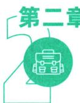

<!-- question-source:start -->
2 从立体图形到平面图形 …… (3) (D2)
课时 1 正方体的展开与折叠 …… 刷基础 提升 (3) (D2)
课时 2 柱体、锥体的展开与折叠 …… 刷基础 (5) (D3)
课时 3 截一个几何体 …… 刷基础 提升 (6) (D3)
课时 4 从三个方向看物体的形状 …… 刷基础 (8) (D4)

全章综合训练 …… 刷中考 章测 (9) (D5)

重难题型微课

骰子点数之和的最值问题 P4T5 几何体的顶点个数问题 P7T3

<!-- question-source:end -->

![[Q00095965A1]]
