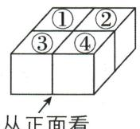
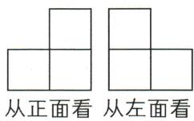

<!-- question-source:start -->
8[2024 宁夏中考改编]用 5 个大小相同的小正方体搭一个几何体,它从正面、左面看到的形状图如图(2),现将其中 4 个小正方体按图(1)方式摆放,则最后一个小正方体应放在 ( )

图(1)

图(2)

A. $①$ 号位置 B. $②$ 号位置 C. $③$ 号位置 D. $④$ 号位置
<!-- question-source:end -->

![[Q00102090A1]]
