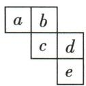
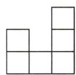
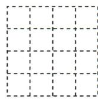

<!-- question-source:start -->
8[2025 广东佛山调研]一个几何体由几个相同的小立方块搭成,从上面和从正面看到的形状图如图所示,从上面看到的形状图中,小正方形中的字母表示在该位置小立方块的个数.

(1) 填空: $a = \_$ , $b = \_$ , $c = \_$ ;

(2)这个几何体最少由\_\_\_\_个小立方块搭成,最多由\_\_\_\_个小立方块搭成;

(3) 当 $d = 2, e = 3$ 时, 请画出从左面看到的这个几何体的形状图.

从上面看

从正面看

从左面看
<!-- question-source:end -->

![[Q00102767A1]]
