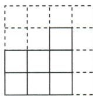

> [!success]- 必刷题
>
> > [!success] **【答案】** 2,1,1
>
> > [!note]- **【解析】**
> > 【解】(1)由题图可知 a=2, b=c=1. 故答案为 2,1,1.
> > (2) 这个几何体最少由 $2+1+1+3+1=8$ (个)
> > 小立方块搭成, 最多由 $2+1+1+3+3=10$ (个)
> > 小立方块搭成. 故答案为 8, 10.
> > (3)从左面看到的形状图如图所示:
> >
> > 
> > 从左面看
> >
> > ## 第二章 有理数及其运算
> >
> > ## 1 认识有理数
