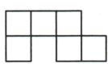
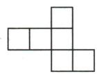
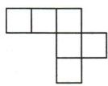
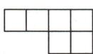

## 全章综合训练 刷中考

建议用时 15 分钟 答案 D2

A

( )

B

C

D

![[初中/课堂同步/教辅/必刷题/2026版《初中必刷题》数学 BS  7上/01_第一章_丰富的图形世界/全章综合训练/questions/Q00097885.md]]
![[初中/课堂同步/教辅/必刷题/2026版《初中必刷题》数学 BS  7上/01_第一章_丰富的图形世界/全章综合训练/questions/Q00097886.md]]
![[初中/课堂同步/教辅/必刷题/2026版《初中必刷题》数学 BS  7上/01_第一章_丰富的图形世界/全章综合训练/questions/Q00097887.md]]
## 知识点 2 正方体的折叠

![[初中/课堂同步/教辅/必刷题/2026版《初中必刷题》数学 BS  7上/01_第一章_丰富的图形世界/全章综合训练/questions/Q00097888.md]]
![[初中/课堂同步/教辅/必刷题/2026版《初中必刷题》数学 BS  7上/01_第一章_丰富的图形世界/全章综合训练/questions/Q00097889.md]]
![[初中/课堂同步/教辅/必刷题/2026版《初中必刷题》数学 BS  7上/01_第一章_丰富的图形世界/全章综合训练/questions/Q00097890.md]]
![[初中/课堂同步/教辅/必刷题/2026版《初中必刷题》数学 BS  7上/01_第一章_丰富的图形世界/全章综合训练/questions/Q00097891.md]]
## 提升
