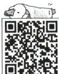
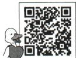

## 全章综合训练 刷中考

是个新“烤”鸭

电子错题本鸭

## 考点1 点、线、面、体

![[初中/课堂同步/教辅/必刷题/2026版《初中必刷题》数学 BS  7上/01_第一章_丰富的图形世界/全章综合训练/questions/Q00102083.md]]

## 考点2 几何体的展开与折叠

![[初中/课堂同步/教辅/必刷题/2026版《初中必刷题》数学 BS  7上/01_第一章_丰富的图形世界/全章综合训练/questions/Q00102084.md]]
![[初中/课堂同步/教辅/必刷题/2026版《初中必刷题》数学 BS  7上/01_第一章_丰富的图形世界/全章综合训练/questions/Q00102085.md]]
![[初中/课堂同步/教辅/必刷题/2026版《初中必刷题》数学 BS  7上/01_第一章_丰富的图形世界/全章综合训练/questions/Q00102086.md]]
![[初中/课堂同步/教辅/必刷题/2026版《初中必刷题》数学 BS  7上/01_第一章_丰富的图形世界/全章综合训练/questions/Q00102087.md]]

## 考点3 从三个方向看几何体的形状

![[初中/课堂同步/教辅/必刷题/2026版《初中必刷题》数学 BS  7上/01_第一章_丰富的图形世界/全章综合训练/questions/Q00102088.md]]
![[初中/课堂同步/教辅/必刷题/2026版《初中必刷题》数学 BS  7上/01_第一章_丰富的图形世界/全章综合训练/questions/Q00102089.md]]
![[初中/课堂同步/教辅/必刷题/2026版《初中必刷题》数学 BS  7上/01_第一章_丰富的图形世界/全章综合训练/questions/Q00102090.md]]
