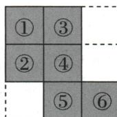

<!-- question-source:start -->
7 如图,在每个小正方形边长都为1的3×3方格纸中,3个白色小正方形已被剪掉,现需在编号为

①\~⑥的小正方形中,再剪掉一个小正方形,从而使余下的5个小正方形恰好能折成一个棱长为1的无盖正方体,则需要再剪掉的小正方形可能是\_\_\_\_.(请填写所有可能的小正方形的编号)
<!-- question-source:end -->

![[Q00102045A1]]
