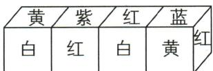

<!-- question-source:start -->
4[2025 四川达州期中, 中]把正方体的六个面分别涂上六种不同的颜色, 并画上朵数不等的花, 各面上的颜色与花朵数的情况如下表:

<table><tr><td>颜色</td><td>红</td><td>黄</td><td>蓝</td><td>白</td><td>紫</td><td>绿</td></tr><tr><td>花朵数</td><td>6</td><td>5</td><td>4</td><td>3</td><td>2</td><td>1</td></tr></table>

现将完全相同的四个上述正方体拼成一个水平放置的长方体,如图所示,那么长方体的下底面共有\_朵花.

<!-- question-source:end -->

![[Q00102050A1]]
