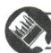

> [!success]- 必刷题
>
> > [!success] **【答案】** ①或②或③
>
> > [!note]- **【解析】**
> > 把题图中的①或②或③剪掉,剩下的图形能折成一个棱长为1的无盖正方体,故答案为①或②或③.
> >
> > ## 关键点拨
> >
> > 正方体的表面展开图, 相对的面之间一定相隔一个正方形, 且不能有公共边和公共顶点.
> >
> > 
