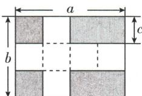

> [!success]- 必刷题
>
> > [!success] **【答案】** $b = 3c$
>
> > [!note]- **【解析】**
> > 【解】(1)由题意可知,做成的无盖正方体纸盒的棱长是 $c \, cm$ , 故可得 $b = 3c$ , 故答案为 $b = 3c$ . (2)设剪去的小正方形的边长为 $c \, cm$ , 则做成的有盖正方体纸盒的棱长为 $c \, cm$ . 如图所示, 由图形可得 $a = 4c$ , $b = 3c$ , 所以 $c = \frac{a}{4} = \frac{b}{3}$ , 则 $b = \frac{3}{4}a$ , 故答案为 $b = \frac{3}{4}a$ .
> >
> > 
> >
> > (3) 设有盖正方体纸盒的棱长为 $x \, cm$ . 由题意得 a = 4x，则 4x = 36，解得 x = 9，所以有盖正方体纸盒的表面积为 $6 \times 9^{2} = 486 \, (\text{cm}^{2})$ .
