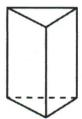
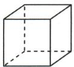
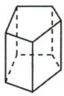
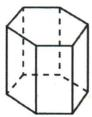

<!-- question-source:start -->
4[2025 山西晋中质检]观察下列多面体,并把下表补充完整.

<table><tr><td>名称</td><td>三棱柱</td><td>四棱柱</td><td>五棱柱</td><td>六棱柱</td></tr><tr><td>图形</td><td></td><td></td><td></td><td></td></tr><tr><td>顶点数a</td><td>6</td><td></td><td></td><td></td></tr><tr><td>棱数b</td><td>9</td><td></td><td></td><td></td></tr><tr><td>面数c</td><td>5</td><td></td><td></td><td></td></tr></table>

(1) 根据表中的规律判断, 十二棱柱共有 \_\_\_\_ 个面, 共有 \_\_\_\_ 个顶点, 共有 \_\_\_\_ 条棱;

(2)若某个棱柱由30个面围成,则这个棱柱为\_\_\_\_棱柱;

(3)若某个棱柱的底面图形的边数为 n, 则它共有 \_\_\_\_ 个侧面, 共有 \_\_\_\_ 个面, 共有 \_\_\_\_ 个顶点, 共有 \_\_\_\_ 条棱;

(4) 观察上表中的结果, 请写出 a, b, c 之间的关系式: \_\_\_\_.
<!-- question-source:end -->

![[Q00102029A1]]
