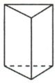
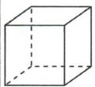
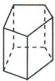
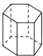
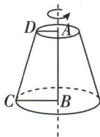

> [!success]- 必刷题
>
> > [!success] **【答案】** B
>
> > [!note]- **【解析】**
> > 如图, 将四边形 ABCD 绕 AB 所在的直线旋转一周, 可得选项 B 的几何体, 选项 A、C、D 中的几何体不能由一个平面图形绕某条直线旋转一周得到. 故选 B.
> >
> > <table><tr><td>名称</td><td>三棱柱</td><td>四棱柱</td><td>五棱柱</td><td>六棱柱</td></tr><tr><td>图形</td><td></td><td></td><td></td><td></td></tr><tr><td>顶点数a</td><td>6</td><td>8</td><td>10</td><td>12</td></tr><tr><td>棱数b</td><td>9</td><td>12</td><td>15</td><td>18</td></tr><tr><td>面数c</td><td>5</td><td>6</td><td>7</td><td>8</td></tr></table>
> >
> > 中，1个面是曲的，2个面是平的，说法错误；
> > - **②**：圆锥由2个面围成，这2个面中，1个面是平的，1个面是曲的，说法正确；
> > - **③**：球仅由1个面围成，这个面是曲的，说法错误；
> > - **④**：长方体由6个面围成，这6个面都是平的，说法正确.故选C.
> >
> > 
> >
> > 答:制作这个笔筒的侧面至少需要 $320 \, cm^{2}$ 的材料.
