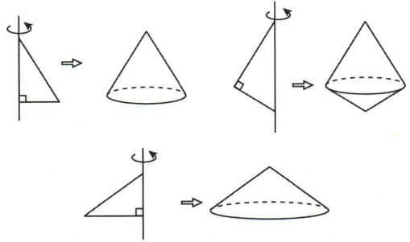

> [!success]- 必刷题
>
> > [!success] **【答案】** C
>
> > [!note]- **【解析】**
> > 若直角三角形分别绕其两条直角边所在直线旋转一周, 可以形成选项 A 和选项 D 中的圆锥; 若直角三角形绕其斜边所在直线旋转一周, 可以形成选项 B 中的几何体,故不可能形成圆柱. 故选 C.
> >
> > 易错警示 将一个直角三角形绕其一条边所在的直线旋转一周, 旋转轴不同, 得到的几何体不同(如图).
> >
> > 
