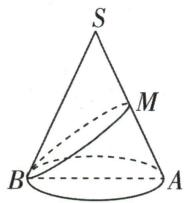
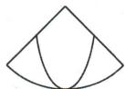
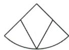
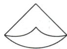
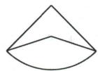

<!-- question-source:start -->
7[2025 广东广州期末]如图, S 是圆锥的顶点, AB 是圆锥底面的直径, M 是 SA 的中点. 在圆锥的侧面上过点 B, M 嵌有一圈路

径最短的金属丝,现将圆锥侧面沿 SA 剪开,所得圆锥的侧面展开图可能是 ( )

A

B

C

D
<!-- question-source:end -->

![[Q00102059A1]]
