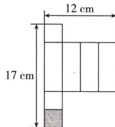

> [!success]- 必刷题
>
> > [!success] **【答案】** 12, 7
>
> > [!note]- **【解析】**
> > 【解】(1)有多余块,如图所示.
> >
> > (2) 长方体共有 12 条棱, 若将一个长方体沿某些棱剪开展成 (1) 中修正后的平面图形, 需要剪开 7 条棱, 故答案为 12, 7.
> >
> > 
> >
> > (3)底面正方形边长为 $12 \div 4 = 3 \, (\text{cm})$ ，长方体的高为 $17 - 3 \times 3 = 8 \, (\text{cm})$ ，所以长方体体积为 $3 \times 3 \times 8 = 72 \, (\text{cm}^{3})$ .
> > 答:修正后的展开图所折叠而成的长方体的体积为 $72 \, cm^{3}$ .
