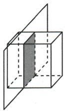
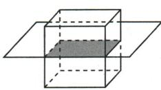
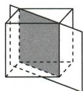
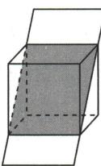
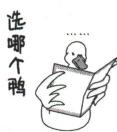

<!-- question-source:start -->
3 如图,用一个平面从不同的角度去截一个正方体,则截面大小、形状 ( )

(1)

(2)

(3)

(4)

A.(1)(2)相同,(3)(4)相同
B.(1)(3)相同,(2)(4)相同
C.(1)(4)相同,(2)(3)相同
D.都不相同

<!-- question-source:end -->

![[Q00102063A1]]
