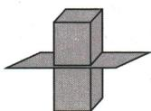
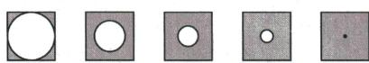

<!-- question-source:start -->
2[2025 广东深圳期中, 中]一个物体的外形是长方体(如图(1)), 其内部构造不祥. 用平面横向自下而上截这个物体时, 得到了一组截面, 截面形状如图(2)所示, 则这个长方体的内部构造可能是 ( )

图(1)

图(2)

A.圆柱 B.球C.圆锥 D.圆柱或球
<!-- question-source:end -->

![[Q00102071A1]]
