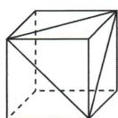
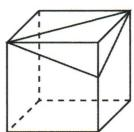
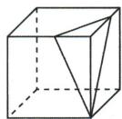
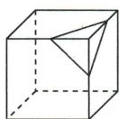

> [!success]- 必刷题
>
> > [!success] **【答案】** D
>
> > [!note]- **【解析】**
> > 如图(1)，剩下的几何体有7个顶点；如图(2)，剩下的几何体有8个顶点；如图(3)，剩下的几何体有9个顶点；如图(4)，剩下的几何体有10个顶点。故选D.
> >
> > 
> > 图(1)
> >
> > 
> > 图(2)
> >
> > 
> > 图(3)
> >
> > 
> > 图(4)
> >
> > 4.36 【解析】因为用一个平面截一个直 $n$ 棱柱, 得到的截面边数最多是 8 条, 所以这个直 $n$ 棱柱有 8 个面, 所以这个几何体是六棱柱. 因为这个棱柱的每个侧面都是正方形, 正方形的面积为 4 , 所以这个六棱柱的所有棱长都相等, 且棱长为 2 , 所以六棱柱的棱长之和为
> >
> > ## ▶归纳总结
> >
> > 判断截面形状的方法: 判断截面的形状时, 首先找出截几何体的平面和几何体的面相交所成的线, 其次判断这些线围成的截面的形状. 若几何体的各个面是平的, 则所得截面是多边形; 若几何体有曲面, 则所得的截面可能是多边形, 也可能是由直线和曲线围成的图形, 还可能是曲线围成的图形, 如圆或椭圆.
> >
> > 正方体有六个面,截面最多与其六个面相交得六边形.
> >
> > ## 关键点拨
> >
> > $2 \times 6 \times 3 = 36$ , 故答案为 36.
