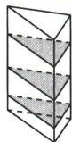
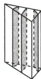
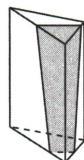

> [!success]- 必刷题
>
> > [!success] **【答案】** 详见解析
>
> > [!note]- **【解析】**
> > 【解】(1)能.如图(1)所示.
> >
> > 
> > 图(1)
> >
> > 
> > 图(2)
> >
> > 
> > 图(3)
> >
> > (2)能.如图(2)所示.(截法不唯一)
> > (3)能.如图(3)所示.(截法不唯一)
