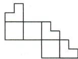

> [!success]- 必刷题
>
> > [!success] **【答案】** B
>
> > [!note]- **【解析】**
> > 【解】(1)由题图可得 $S_{1} = S$ . 故答案为 B. (2)不对. 理由: 设大正方体棱长为 $y$ , 被截去的小正方体棱长为 $x$ , 那么 $l_{1} - l = 6x$ . 只有当 $6x = 3y$ , 即 $2x = y$ 时, 才有 $l_{1}$ 比 $l$ 正好多出大正方体 3 条棱的长度, 所以小明说的话不对. (3)不是. 修正后如图所示:
> >
> > 
