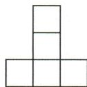
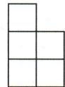

<!-- question-source:start -->
5[2025 山东泰安期中]用大小相同的小正方体搭一个几何体,使它满足以下条件:从正面、左面看到的这个几何体的形状图如图所示.
(1) 搭成这样的几何体最多需要多少个小正方体? 最少需要多少个小正方体?
(2) 请你画出最多小正方体搭成的几何体从上面看到的形状图,并在小正方形内标注该位置

小正方体的个数.

从正面看

从左面看
<!-- question-source:end -->

![[Q00102081A1]]
