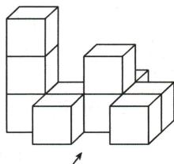

<!-- question-source:start -->
6[2024 江西九江期中]如图,在平整的地面上,用多个棱长都为 2 cm 的小正方体堆成一个几何体.
(1) 共有 \_\_\_\_ 个小正方体;

(2)若在几何体表面(露出部分,不含底面)喷漆,求这个几何体喷漆的面积;

(3)如果现在你还有一些棱长都为2 cm的小正方体,要求保持从上面和从左面看到的图形都不变,最多可以再添加\_\_\_\_个小正方体.

从正面看
<!-- question-source:end -->

![[Q00102082A1]]
