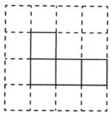
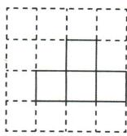
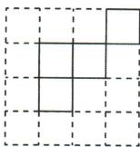
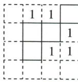

> [!success]- 必刷题
>
> > [!success] **【答案】** 5
>
> > [!note]- **【解析】**
> > 【解】(1)如图(1)所示:
> >
> > 
> > 从正面看
> >
> > 
> > 从左面看
> > 图(1)
> >
> > 
> > 从上面看
> >
> > (2)如图(2),在备注数字的位置添加相应数量的小正方体,从正面和从左面看到的形状图不变,所以最多可以再添加5个小正方体,故答案为5.
> >
> > 
> > 从上面看
> > 图(2)
