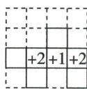
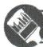

> [!success]- 必刷题
>
> > [!success] **【答案】** 10
>
> > [!note]- **【解析】**
> > 【解】(1)由题图可得共有10个小正方体,故答案为10.
> >
> > (2)分析这个图形可得这个几何体喷漆的面
> >
> > 积为 $[(7 + 5) \times 2 + 7 + 4] \times 2^2 = 140(\mathrm{cm}^2)$ .
> >
> > (3) 如图所示, 最多可以再添加 5 个小正方体, 故答案为 5.
> >
> > 
> > 从上面看
> >
> > ## 刷有所得
> >
> > 画由小立方块搭成的几何体从三个方向看得到的形状图:(1)从正面看,所得的形状图反映几何体的左右列数(纵向)和上下层数;(2)从左面看,所得的形状图反映几何体的前后行数和上下层数;(3)从上面看,所得的形状图反映几何体的前后行数和左右列数(纵向).
> >
> > ## 易错警示
> >
> > 当几何体没有凹陷时, 几何体的表面积 = 2(正面积 + 左面积 + 上面积); 当几何体有凹陷时, 凹陷部分面积要单独计算.
> >
> > # 全章综合训练
> >
> > 
