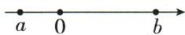

<!-- question-source:start -->
4[2025 安徽淮北期末]有理数 a, b 对应的点在数轴上的位置如图所示, 则下列结论正确的是 ( )

A. $a + b <   0$ B. $\frac{a}{b} >0$ C. $a > b$ D. $a - b <   0$
<!-- question-source:end -->

![[Q00102815A1]]
