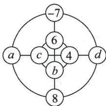

> [!success]- 必刷题
>
> > [!success] **【答案】** A
>
> > [!note]- **【解析】**
> > 如图, 设内圈上的数为 c, 外圈上的数为 d. 因为 $(-1) + 2 + (-3) + 4 + (-5) + 6 + (-7) + 8 = 4$ , 横、竖以及内外两圈上的 4 个
> >
> > 
> >
> > 数字之和都相等,所以内外两圈的和都是2,横、竖的和也都是2.由 $-7+6+b+8=2$ ,得b=-5;由 $6+4+b+c=2$ ,得c=-3;由 $a+c+4+d=2$ ,得 $a+d=1$ .由题意可知,a和d代表的数字为-1和2.当a=-1时,d=2,则 $a+b=-1+(-5)=-6$ ;当a=2时,d=-1,则 $a+b=2+(-5)=-3$ .故选A.
> >
> > 关键点拨
> > 根据题意得出内外两圈的和都是2,横、竖的和也都是2是解题关键.
