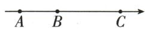
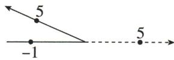

<!-- question-source:start -->
1[中]如图,在数轴上,点A表示数a,点B表示数b,点C表示数c,b是最小的正整数,且a,c满足 $|a+2|+(c-6)^{2}=0$ .
(1) $a=$ \_\_\_\_, $b=$ \_\_\_\_, c= \_\_\_\_.

(2)若将数轴折叠,使得点A与点C重合,则折痕与数轴的交点所表示的数为\_\_\_\_,点B与数\_\_\_\_对应的点重合,这时如果M,N(M在N的左侧)两点之间的距离为2022,且M,N两点经折叠后重合,则点M表示的数是\_\_\_\_,点N表示的数是\_\_\_\_.

(第1题图)
(第2题图)
<!-- question-source:end -->

![[Q00102792A1]]
