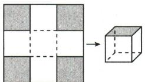
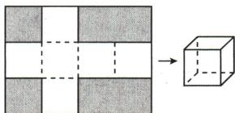

<!-- question-source:start -->
6 核心素养 几何直观 [2024 河南济源期末,较难] 小明用一张正方形的纸板,按如图(1)所示的方式先在纸板四角剪去四个同样大小的小正方形,折合起来就可以做成一个无盖的正方体纸盒.小亮用一张长方形的纸板,按如图(2)所示的方式在纸板的四角剪去两个同样大小的小正方形和两个同样大小的小长方形,剩余部分折合起来恰好可以做成一个有盖的正方体纸盒.

  
图(1)

  
图(2)

现有一张长为 a cm, 宽为 b cm 的长方形纸板, 请探究:

(1) 若 a=b，按图(1)所示的方式剪去的小正方形边长为 c cm，做成一个无盖的正方体纸盒，你发现 c 与 b 之间存在的数量关系为 \_\_\_\_；

(2) 若 a > b，按如图(2)方式裁剪，做成一个有盖的正方体纸盒，你发现 a 与 b 之间存在的数量关系为 \_\_\_\_；

(3) 在 (2) 的条件下, 若 $a = 36$ , 求有盖正方体纸盒的表面积.
<!-- question-source:end -->
