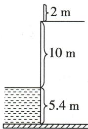

<!-- question-source:start -->
5[中]如图,一名跳水运动员参加10 m跳台的跳水比赛(10 m跳台是指跳台离水面的高度为10 m),这名运动员举高手臂时身长为2 m,跳水池深为5.4 m.(规定向上为正)

(1) 若以水面为基准, 则这名运动员指尖的高度及池底的深度分别如何表示?

(2) 若以跳台为基准, 则池底的深度与水面的高度分别如何表示?

<!-- question-source:end -->

![[Q00102113A1]]
