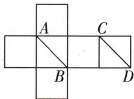
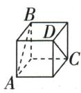
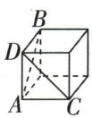
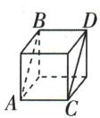
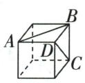

## 课时 1 有理数 刷基础

( )

A

B

C

D

![[初中/课堂同步/教辅/必刷题/2026版《初中必刷题》数学 BS  7上/02_第二章_有理数及其运算/课时_1_有理数/questions/Q00097893.md]]
![[初中/课堂同步/教辅/必刷题/2026版《初中必刷题》数学 BS  7上/02_第二章_有理数及其运算/课时_1_有理数/questions/Q00097894.md]]
![[初中/课堂同步/教辅/必刷题/2026版《初中必刷题》数学 BS  7上/02_第二章_有理数及其运算/课时_1_有理数/questions/Q00097895.md]]
![[初中/课堂同步/教辅/必刷题/2026版《初中必刷题》数学 BS  7上/02_第二章_有理数及其运算/课时_1_有理数/questions/Q00097896.md]]
## 刷素养

走向重高

![[初中/课堂同步/教辅/必刷题/2026版《初中必刷题》数学 BS  7上/02_第二章_有理数及其运算/课时_1_有理数/questions/Q00097897.md]]
# 课时 2 柱体、锥体的展开与折叠

建议用时 15 分钟 答案 D3

## 知识点 1 棱柱的展开与折叠
