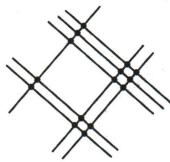
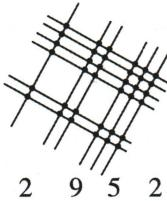
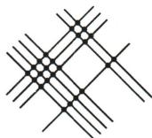

<!-- question-source:start -->
7[2025 河南濮阳期中]现有一种“划线法”解决有理数的乘法运算: 图(1)表示的乘法算式是 $12 \times 23 = 276$ ; 图(2)表示的乘法算式是 $123 \times 24 = 2952$ . 则图(3)表示的乘法算式

是\_\_\_\_。

123×24=2952

图(1)
图(2)
图(3)
<!-- question-source:end -->

![[Q00102224A1]]
