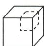
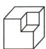
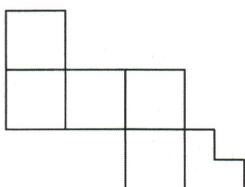

<!-- question-source:start -->
7[2024 广东揭阳期中,较难]如图(1),从大正方体上截去一个小正方体之后,可以得到图(2)的几何体.

(1)设原大正方体的表面积为 S, 图(2)中几何体的表面积为 $S_{1}$ ，那么 $S_{1}$ 与 S 的大小关系是 \_\_\_\_。
A. $S_{1} > S$ B. $S_{1} = S$ C. $S_{1} < S$ D. 无法确定

(2) 小明说: “设图(1)中大正方体各棱的长度之和为 $l$ , 图(2)中几何体各棱的长度之和为 $l_{1}$ , 那么 $l_{1}$ 比 $l$ 正好多出大正方体 3 条棱的长度.” 你认为这句话对吗? 为什么?

(3)如果截去的小正方体的棱长为大正方体棱长的一半,那么图(3)是图(2)中几何体的表面展开图吗?如有错误,请予修正.

  
图(1)

  
图(2)

  
图(3)
<!-- question-source:end -->
