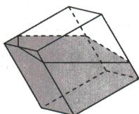

## 课时 1 有理数的加法 刷基础

A.三角形 B.正方形 C.六边形 D.七边形

![[初中/课堂同步/教辅/必刷题/2026版《初中必刷题》数学 BS  7上/02_第二章_有理数及其运算/课时_1_有理数的加法/questions/Q00097916.md]]
![[初中/课堂同步/教辅/必刷题/2026版《初中必刷题》数学 BS  7上/02_第二章_有理数及其运算/课时_1_有理数的加法/questions/Q00097917.md]]
![[初中/课堂同步/教辅/必刷题/2026版《初中必刷题》数学 BS  7上/02_第二章_有理数及其运算/课时_1_有理数的加法/questions/Q00097918.md]]
![[初中/课堂同步/教辅/必刷题/2026版《初中必刷题》数学 BS  7上/02_第二章_有理数及其运算/课时_1_有理数的加法/questions/Q00097919.md]]
![[初中/课堂同步/教辅/必刷题/2026版《初中必刷题》数学 BS  7上/02_第二章_有理数及其运算/课时_1_有理数的加法/questions/Q00097920.md]]
![[初中/课堂同步/教辅/必刷题/2026版《初中必刷题》数学 BS  7上/02_第二章_有理数及其运算/课时_1_有理数的加法/questions/Q00097921.md]]
# 课时4 从三个方向看物体的形状

## 知识点 1 由立体图形得到物体的三个方向的形状图
