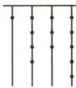

<!-- question-source:start -->
3 新考向传统文化 我国古代《易经》一
书记载,远古时期,人们通过在绳子
上打结来记录数量.如图,一位母亲
在从右到左依次排列的绳子上打结,并采用七
进制(如2513=2×7 $^{3}$ +5×7 $^{2}$ +1×7 $^{1}$ +3)来记录孩子
自出生后的天数,由图可知,孩子自出生后的天数
是
A. 1 435    B. 565    C. 13    D. 465

<!-- question-source:end -->

![[Q00102289A1]]
