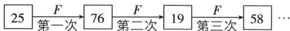

<!-- question-source:start -->
5[2024 广东广州调研, 中]定义一种对正整数 n 的“F 运算”: ① 当 n 为奇数时, 结果为 $3n + 1$ ; ② 当 n 为偶数时, 结果为 $\frac{n}{2^{k}}$ (其中 k 是使 $\frac{n}{2^{k}}$ 为奇数的最小正整数). 并且运算可以重复进行, 例如, 取 n = 25 时, 运算过程如图. 若 n = 34, 则第 2023 次“F 运算”的结果是 \_\_\_\_.

<!-- question-source:end -->

![[Q00102302A1]]
