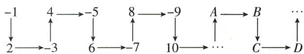

<!-- question-source:start -->
4 [中] 如图, 将一串有理数按下列规律排列, 回答下列问题:

(1) 在 A 处的数是\_\_\_\_（填“正数”或“负数”）.

(2) 在 A, B, C, D 四个位置, \_\_\_\_ 所在位置的数是负数.

(3)第2024个数是\_\_\_\_（填“正数”或“负数”），位于A,B,C,D中的\_\_\_\_处.
<!-- question-source:end -->
