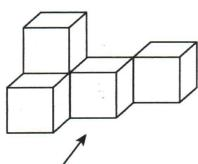
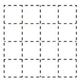
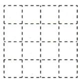
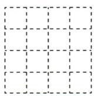

<!-- question-source:start -->
3 如图是由棱长都为 $1 \, cm$ 的 5 个小正方体组成的几何体.

  
从正面看

  
从正面看

  
从左面看

  
从上面看

(1)从正面、左面、上面观察该几何体,请在网格图中分别画出你所看到的几何体的形状图;

(2)如果在这个几何体上再添加一些棱长也都为1 cm的小正方体,并保持从正面和从左面看到的形状图不变,那么最多可以再添加\_\_\_\_个小正方体.
<!-- question-source:end -->
